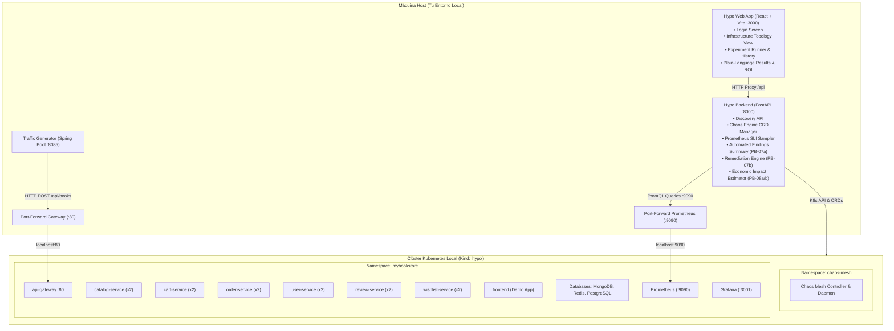

# Guía Definitiva: Despliegue de Hypo Platform y Demo App para Presentación en Vivo

Esta guía contiene la secuencia **completa, probada y validada en vivo** para levantar todo el ecosistema desde cero en Windows (PowerShell), generar tráfico real y realizar una presentación profesional de la plataforma de ingeniería del caos **Hypo**.

---

## 🗺️ Mapa General del Ecosistema



---

## 📋 PARTE 1: Despliegue de Infraestructura y Demo App

> Ejecuta estos comandos desde la raíz del proyecto en PowerShell:
> `C:\Users\emanu\Documentos\Clases\2026-2\Proyecto TI\hypo`

### 1.1 Crear el Clúster Kind
```powershell
kind create cluster --name hypo --config=infra/kind-config.yaml
kubectl get nodes
```

---

### 1.2 Compilar y Cargar las Imágenes de la Demo App en Kind
Kind necesita las imágenes en sus nodos para no intentar descargarlas de un registro externo:

```powershell
# Compilar imágenes en Docker local
docker build -t mybookstore/catalog-service:dev workload/demo-app/microservices/catalog-service
docker build -t mybookstore/user-service:dev workload/demo-app/microservices/user-service
docker build -t mybookstore/cart-service:dev workload/demo-app/microservices/cart-service
docker build -t mybookstore/order-service:dev workload/demo-app/microservices/order-service
docker build -t mybookstore/review-service:dev workload/demo-app/microservices/review-service
docker build -t mybookstore/wishlist-service:dev workload/demo-app/microservices/wishlist-service
docker build --build-arg VITE_API_URL=/ -t mybookstore/frontend:dev workload/demo-app/frontend

# Cargar imágenes al clúster Kind 'hypo'
kind load docker-image mybookstore/catalog-service:dev --name hypo
kind load docker-image mybookstore/user-service:dev --name hypo
kind load docker-image mybookstore/cart-service:dev --name hypo
kind load docker-image mybookstore/order-service:dev --name hypo
kind load docker-image mybookstore/review-service:dev --name hypo
kind load docker-image mybookstore/wishlist-service:dev --name hypo
kind load docker-image mybookstore/frontend:dev --name hypo
```

---

### 1.3 Desplegar la Demo App en el Namespace `mybookstore`
```powershell
# Aplicar todos los manifiestos mediante kustomize
kubectl apply -k infra/demo-app

# Verificar que todos los pods estén en estado 'Running'
kubectl get pods -n mybookstore
```

---

### 1.4 Instalar Chaos Mesh
Instala Chaos Mesh apuntando al namespace objetivo de la aplicación (`mybookstore`):
```powershell
helm repo add chaos-mesh https://charts.chaos-mesh.org
helm repo update
helm install chaos-mesh chaos-mesh/chaos-mesh `
  --namespace chaos-mesh --create-namespace `
  --set controllerManager.targetNamespace=mybookstore `
  --set dashboard.enabled=true

# Verificar que los pods de Chaos Mesh estén activos
kubectl get pods -n chaos-mesh
```

---

## 🔌 PARTE 2: Conectividad y Generador de Tráfico (Clave para Métricas Reales)

Para que Hypo lea las métricas SLI reales y el fallo genere un impacto observable, necesitas exponer Prometheus y encender el tráfico.

### 2.1 Exponer Prometheus (Terminal dedicada)
Abre una terminal de PowerShell y déjala corriendo:
```powershell
kubectl port-forward -n mybookstore svc/prometheus 9090:9090
```
> [!NOTE]
> Esto permite que el backend de Hypo consulte `http://localhost:9090` en tiempo real.

### 2.2 Exponer el API Gateway de la Demo App (Terminal dedicada)
Abre otra terminal de PowerShell y déjala corriendo:
```powershell
kubectl port-forward -n mybookstore svc/api-gateway 80:80
```
*(Si el puerto 80 local está ocupado en tu máquina por otro servicio, puedes usar `8080:80` asegurando actualizar la URL base en el generador de tráfico).*

### 2.3 Iniciar y Encender el Generador de Tráfico
El generador de tráfico está configurado en el puerto **`8085`** (para no chocar con el puerto 8080 ni 8000).

1. **Iniciar el servidor Spring Boot**:
   ```powershell
   cd trafficgenerator
   .\mvnw.cmd spring-boot:run
   ```

2. **Iniciar la simulación continua de peticiones** (en otra terminal o tras levantar el servidor):
   ```powershell
   Invoke-RestMethod -Uri "http://localhost:8085/simulate/start" -Method Post
   ```
   **Respuesta esperada:** `"Simulación iniciada"`. Ahora hay flujo constante de usuarios consultando `/api/books`.

---

## 💻 PARTE 3: Iniciar la Plataforma Hypo

### 🟢 Terminal Hypo Backend (FastAPI)
```powershell
cd backend

# Activar entorno virtual de Python
.venv\Scripts\Activate.ps1

# (Si es primera vez o faltan dependencias)
pip install -e ".[dev]"

# Iniciar backend
uvicorn app.main:app --reload --host 0.0.0.0 --port 8000
```
- API activa: `http://localhost:8000`
- Swagger OpenAPI: `http://localhost:8000/docs`

---

### 🔵 Terminal Hypo Frontend (React + Vite)
```powershell
cd frontend

# Iniciar aplicación web
npm run dev
```
- Consola Web de Hypo: **`http://localhost:3000`**

---

## 🎤 PARTE 4: Guión de Presentación en Vivo (Storytelling de Impacto)

Abre **`http://localhost:3000`** en tu navegador. Sigue este recorrido:

```
[Login SRE] ➡️ [Discovery] ➡️ [Experimento con Fallo Real] ➡️ [Resumen PB-07a] ➡️ [Recomendaciones PB-07b] ➡️ [ROI Económico PB-08]
```

### 1. Inicio y Propuesta de Valor
- **Pantalla**: Login (`http://localhost:3000`).
- **Acción**: Haz clic en **"Continuar como SRE Engineer"**.
- **Discurso**:
  > *"Hypo resuelve el problema de la resiliencia en PYMEs. Hoy las herramientas de caos requieren ingenieros dedicados y son complejas. Hypo automatiza todo el ciclo: descubre los servicios, guía la hipótesis, mide con Prometheus y traduce los fallos técnicos a lenguaje de negocio y dinero real."*

### 2. Descubrimiento de Infraestructura (Discovery)
- **Pantalla**: Pestaña **"Infraestructura"**.
- **Acción**: Selecciona el namespace **`mybookstore`**.
- **Demostración**:
  - Muestra cómo Hypo mapea en vivo los microservicios (`catalog-service`, `cart-service`, `order-service`) y sus bases de datos.
  - Muestra el estado de réplicas deseadas vs. listas.

### 3. Ejecución de un Experimento con Falla Evidente (FAIL)
Para una demo impactante donde se aprecien métricas alteradas y costos económicos, usa uno de estos dos escenarios:

- **Escenario 1 (Recomendado): Latencia en Cart Service (`network-delay`)**
  - **Servicio**: `cart-service`.
  - **Tipo**: `network-delay`.
  - **Latencia**: `250ms`.
  - **SLO Latencia P95**: `100ms` (para que el fallo sea evidente).
  - Haz clic en **"Ejecutar Experimento"**.

- **Escenario 2: Caída total de Catalog Service (`pod-kill` 100%)**
  - **Servicio**: `catalog-service`.
  - **Tipo**: `pod-kill`.
  - **Blast Radius**: `100%` (mata todas las réplicas simultáneamente para forzar indisponibilidad temporal).
  - **Duración**: `30 segundos`.

### 4. Resumen Automático de Hallazgos (PB-07a)
- **Pantalla**: **"Historial de Ejecuciones"** ➡️ Selecciona la ejecución.
- **Qué destacar**:
  - **Tabla de 3 Ventanas**: Compara `Antes (Baseline)`, `Durante el Caos` (donde la latencia se dispara o la tasa de error sube) y `Después (Recuperación)`.
  - **Veredicto**: `FAIL` (Violación del SLO).
  - **Resumen en Lenguaje Natural**: Muestra cómo el sistema redacta el diagnóstico ejecutivo de forma automática:
    > *"El servicio experimentó una degradación crítica con un incremento de latencia P95 a 290ms y una tasa de error del 15% durante la inyección, recuperando su estado estable en X segundos."*

### 5. Recomendaciones de Remediación (PB-07b)
- **Qué destacar**: Despliega la sección de **"Recomendaciones"** en la tarjeta.
- **Discurso**:
  > *"Hypo no se limita a reportar la falla. El motor de prescripción indica exactamente las medidas técnicas a implementar: por ejemplo, `REC-NET-TIMEOUT-01` (ajuste de timeouts y circuit breaker) o `REC-POD-PDB-01` (creación de PodDisruptionBudget). Cada una clasificada por su severidad (Alta, Media, Crítica)."*

### 6. Evaluación de Impacto Económico (PB-08a / PB-08b)
- **Qué destacar**: La tarjeta de **"Impacto Financiero Estimado"**.
- **Discurso**:
  > *"Esta es la ventaja competitiva de Hypo: traduce el fallo técnico a números de negocio. A partir del costo por hora configurado, el tiempo de degradación y la fórmula matemática visible, Hypo calculó una pérdida estimada de $X USD. Esto permite a los líderes de tecnología justificar la inversión en resiliencia ante directores y gerentes."*

---

## 🛡️ PARTE 5: Prueba de Respaldo Técnico (E2E Tests)

Si en la sesión de preguntas te piden verificar la robustez del código y los tests:

```powershell
cd backend
.venv\Scripts\Activate.ps1

# Ejecutar las 3 pruebas end-to-end completas
pytest tests/test_e2e_pipeline.py -v

# Ejecutar la suite completa (122 pruebas unitarias e integración)
pytest tests/
```

Ambas pruebas correrán y pasarán al 100%.

---

## 🧹 PARTE 6: Limpieza Final

Cuando termines tu presentación:
```powershell
kind delete cluster --name hypo
```
